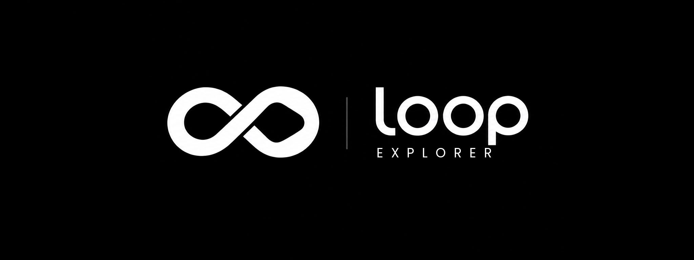

# Loop Explorer



Gerenciador de arquivos de código aberto para TV Box, Android TV e Google TV, feito para o controle remoto: simples, leve e sem anúncios. Faz parte da família [Loop](https://github.com/DarkModeBR/LoopApps), junto com o Loop Launcher.
*Open source file manager for TV boxes, Android TV and Google TV, made for the remote control. English below.*

## O que ele faz

- Painel à esquerda com o Servidor HTTP e os armazenamentos: memória do aparelho e pen drives, com o espaço livre de cada um
- Menus numa janela no centro da tela, que ocupa a tela inteira quando o conteúdo é grande
- Copia, move, apaga, renomeia e cria pastas, com barra de progresso e botão para cancelar
- Seleciona vários arquivos de uma vez
- Compacta em ZIP e extrai arquivos ZIP
- Mostra o APK antes de instalar: nome, ícone, versão e se já está instalado
- Mostra fotos em tela cheia, passando de uma para outra com as setas
- Toca vídeos e músicas, com as músicas seguindo para a próxima da pasta
- Abre os outros tipos de arquivo no app que o aparelho tiver
- Lista (padrão) ou cards, com ícones coloridos por tipo e miniaturas de fotos, vídeos, capas de música e APKs
- Tema escuro ou claro, com fundo liso; cor neutra em preto e cinza por padrão, ou uma de oito cores de destaque
- **Servidor HTTP:** abre o aparelho pelo navegador de um computador ou celular na mesma rede
- Português e inglês
- Avisa quando há versão nova no GitHub
- Sem anúncios e sem coleta de dados de uso

Requer Android 7.0 ou superior.

## Servidor HTTP

Ligue em **Servidor HTTP**, a primeira linha do painel à esquerda, e abra no navegador o endereço que aparece, como `http://192.168.0.10:8080`. A página tem:

- **Arquivos:** como um explorador de arquivos do computador, com lista ou ícones e miniaturas, botão direito, seleção com Ctrl e Shift, atalhos de teclado (Ctrl+C, Ctrl+V, Del, F2), copiar e colar entre pastas, mover, renomear, compactar, extrair, apagar, baixar e enviar arrastando
- **Status:** marca, modelo, Android, chip, núcleos, frequência, temperatura, uso do processador, memória, armazenamento, tela e tempo ligado
- **Verificação de informações falsas:** compara o que o aparelho diz com o que o kernel e o hardware mostram (versão do Android, memória, armazenamento, núcleos, marca, chip e resolução) e marca cada item como OK, Suspeito ou Falso
- **Terminal:** roda comandos com o poder do `adb shell` quando o [Shizuku](https://shizuku.rikka.app) está ligado, ou só com as permissões do app sem ele. Cada comando tem até 30 segundos
- **Apps:** lista, abre, para e desinstala apps, e instala APKs enviados pelo navegador
- **Tela:** captura o que está na TV agora
- **Energia:** suspender, reiniciar e desligar

Na TV, a tela do servidor mostra em cards os aparelhos com a página aberta: se é celular, tablet, computador ou TV, o sistema, o navegador, o IP e há quanto tempo está conectado.

O servidor continua ligado com o app fechado, até ser desligado ou o aparelho reiniciar. **Não há senha:** qualquer aparelho na mesma rede pode usar tudo isso. Desligue quando não estiver usando.

## Permissões

- **Android 10 ou anterior:** o app pede acesso aos arquivos na primeira abertura.
- **Android 11 ou superior:** um gerenciador de arquivos precisa do acesso a todos os arquivos. Muitos sistemas de TV não têm essa tela; nesse caso, o app oferece o Shizuku ou este comando:

  ```
  adb shell appops set com.loop.explorer MANAGE_EXTERNAL_STORAGE allow
  ```

- **Pen drive:** para gravar, o Android pede uma vez que você escolha o pen drive na tela do sistema e toque em Permitir.

## Como compilar

Requer JDK 17 e o Android SDK.

```
./gradlew assembleDebug
```

Para a versão assinada, crie o arquivo `.ravager/keystore.properties` na sua pasta de usuário, fora do projeto, com `storeFile`, `storePassword`, `keyAlias` e `keyPassword`, e rode `./gradlew assembleRelease`.

## Licença

Criado por [DarkModeBR](https://github.com/DarkModeBR). Licença [MIT](LICENSE).

- **Fontes:** Poppins, Barlow, Prompt e Oxygen, sob a SIL Open Font License 1.1.
- **Ícones da página web:** [Bootstrap Icons](https://icons.getbootstrap.com), licença MIT, incluídos no app para a página funcionar sem internet.
- As licenças completas ficam em `app/src/main/assets/licenses/`.

---

## English

A file manager for the TV remote: the HTTP server and the storages in a panel on the left, menus in a window in the middle of the screen, copy, move, delete, rename, new folders, multiple selection, ZIP, APK install with details, photo viewer, video and music player, list (default) or cards with colored icons and thumbnails, dark or light theme in neutral black and gray or one of eight accent colors. No ads and no usage data collection. Requires Android 7.0 or later.

**HTTP server:** turn it on from the first row of the left panel and open the address it shows in a browser on the same network. The TV shows a card for each connected device: phone, tablet, computer or TV, its system, browser, IP and connection time. The page has files (upload, download and manage), device status with a check for fake information, a terminal (with `adb shell` rights through Shizuku), apps (open, stop, uninstall and install APKs), a screenshot of the TV and power buttons. It keeps running with the app closed until it is turned off or the device restarts. **There is no password:** anyone on the same network can use it.

On Android 11 or later it needs access to all files. When the device has no screen for that, use Shizuku or `adb shell appops set com.loop.explorer MANAGE_EXTERNAL_STORAGE allow`.

Icons: [Bootstrap Icons](https://icons.getbootstrap.com) (MIT), included in the app so the page works without internet.

**License:** created by [DarkModeBR](https://github.com/DarkModeBR), under the [MIT](LICENSE) license.
